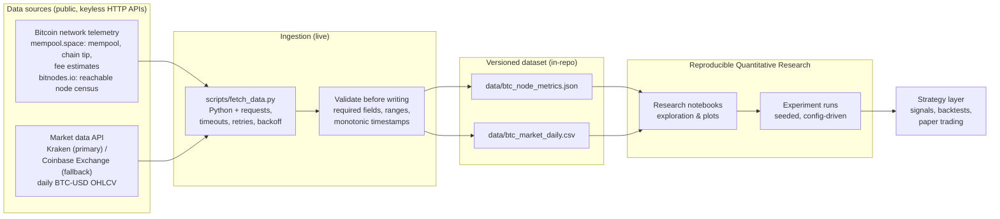
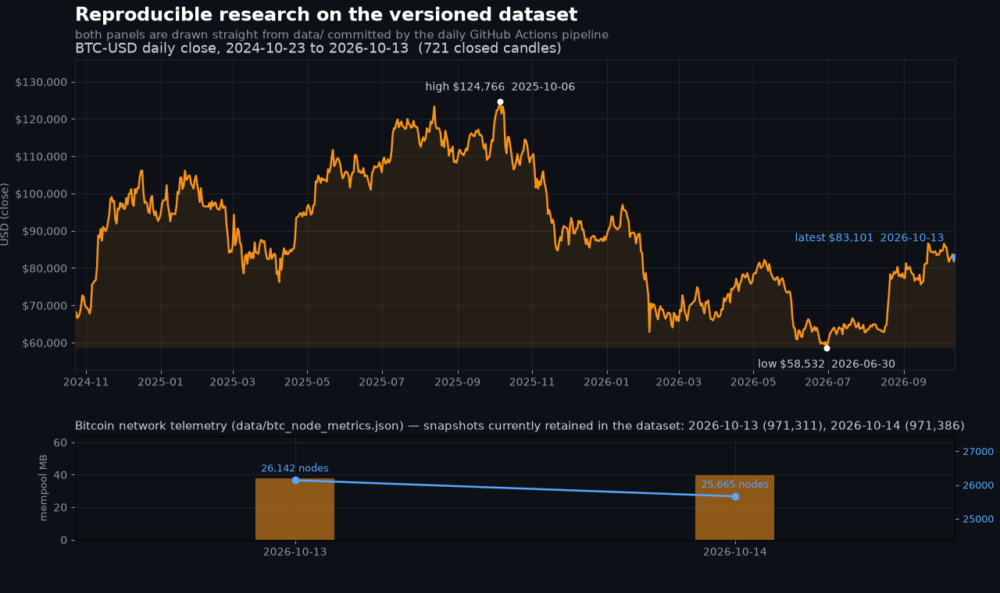

# Bitcoin Node & Market Data Toolkit for AI Algorithmic Trading

**An open-source home for the live Bitcoin node & market dataset this project publishes, and for the algorithmic-trading research scaffolding built on top of it: a scheduled pipeline that versions real Bitcoin network telemetry and BTC-USD market data into the repository, plus the reproducible quantitative experiments and AI-driven strategy work that consume it.**

### Why star this repo

- **Live daily pipeline, real versioned data.** A scheduled GitHub Actions job fetches *Bitcoin network telemetry* and *BTC-USD market data* every day, validates it, and commits only what changed — no heartbeat commits, no hand-written rows. The committed dataset currently holds **721 closed daily candles (2024-10-23 → 2026-10-13)** plus the latest node/mempool snapshots.
- **Bitcoin data most repositories don't have.** Mempool congestion, recommended fees, chain-tip height and the `bitnodes.io` reachable-node census, joined to daily OHLCV on UTC date — network state, not another copy of the price.
- **Reproducible quantitative finance, not a notebook screenshot.** The data is byte-addressable in git, so a result is reproducible against the exact dataset revision it was computed from. Clone it and you have the same inputs, the same seeds and the same code path as everyone else.
- **CI-verified on every push.** `scripts/check_repo.py` runs in `.github/workflows/ci.yml` and fails the build if the community files, CI wiring, README structure or dataset schema drift.
- **Machine learning strategy layer, kept honest.** Signals, cost-aware backtests and a paper-trading (trading-bot) adapter are the *next* milestone and are labelled **planned** everywhere in this README — there are no invented accuracy numbers, benchmarks or user counts, only measured results and explicit "not built yet" labels.
- **Good first issues for contributors, MIT licensed.** Entry-point tasks are scoped to be finished in one sitting with the exact files named in the issue, and everything here is reusable under a permissive license.

> **Related / original project:** this repository previously hosted the *Global BTC Nodes Dashboard*. Its original README is preserved verbatim at [`docs/legacy/global-btc-nodes-readme.md`](docs/legacy/global-btc-nodes-readme.md) and its live demo still runs at [global-btc-nodes.preview.emergentagent.com](https://global-btc-nodes.preview.emergentagent.com/).

[](https://github.com/virtualtradrs/global-btc-nodes/actions/workflows/ci.yml)
[](LICENSE)
[](https://www.python.org/downloads/)
[](https://github.com/virtualtradrs/global-btc-nodes/commits/main)
[](https://github.com/virtualtradrs/global-btc-nodes/issues)
[](https://github.com/virtualtradrs/global-btc-nodes/stargazers)


---

## Why this exists

Most algorithmic trading repositories are a single notebook that imports a CSV nobody can find, alongside a backtest with no recorded parameters. You can read the code, but you cannot reproduce the result — and you cannot tell whether the strategy was ever run on anything except a hand-picked slice of history.

This project is the opposite of that. It is a **reproducible starting point for AI-driven algorithmic trading research**: the data comes in through a scheduled, versioned pipeline; the dataset lives in the repository as plain JSON and CSV; and every research artifact is driven by a config file you can re-run. Clone it and you have the same inputs, the same seeds and the same code path as everyone else.

The two goals, in order:

1. **Reproducibility.** If a result cannot be regenerated by a stranger from a clean clone, it does not count.
2. **Honesty.** No invented benchmarks, no accuracy percentages lifted from nowhere, no "trusted by" logos. Numbers in this repo are measured, and anything that has not been built yet is labelled as planned.

> **Project status:** the repository scaffolding, the documentation, the CI health check and the daily data pipeline are live today — a scheduled GitHub Actions job fetches Bitcoin network telemetry (mempool.space, bitnodes.io) and BTC-USD market data, validates it, and commits the updated dataset to `data/`. The research notebooks and the strategy layer are the next milestone; every section below marks clearly whether it **exists now** or is **planned**. See [Roadmap](#roadmap).

---

## Architecture

The design goal is a straight line from raw data to a strategy you can trust, with every hop inspectable:



**How to read this:** sources → ingestion → dataset → research → strategy. Ingestion and the dataset are *live* today; the research and strategy stages are labelled *planned* because they are the next milestone. The arrows are the interface contract the pipeline implements, so notebooks and strategies can be written against stable file paths and column names.

---

## How it works

*(Live. This is what the code in this repository does today.)*

A GitHub Actions workflow (`.github/workflows/auto-update.yml`) runs once a day, and `scripts/fetch_data.py` does all of the work in one process:

1. **Fetches Bitcoin network telemetry** from public, keyless HTTP APIs into `data/btc_node_metrics.json`, one entry per UTC date:
   - `mempool.space` `/api/mempool` — mempool transaction count, vsize and total fees
   - `mempool.space` `/api/blocks/tip/height` — chain tip height
   - `mempool.space` `/api/v1/fees/recommended` — fee estimates in sat/vB
   - `bitnodes.io` `/api/v1/snapshots/latest/` — the census of reachable Bitcoin **nodes**, which is the "Bitcoin Nodes" half of the project
2. **Pulls market data** — daily BTC-USD OHLCV candles — from Kraken's public OHLC endpoint, falling back to Coinbase Exchange if Kraken is unavailable, and appends only the days that have closed to `data/btc_market_daily.csv`. The in-progress UTC day is deliberately not written: an unfinished candle is not a daily bar.
3. **Validates before writing**, so bad data can never reach a tracked file: required fields present, no nulls in numeric fields, timestamps strictly increasing and unique, every value inside a declared sane range, and the chain tip cross-checked against the node-census height. Validation failure exits non-zero and *no tracked file is modified* — a red run leaves the last good dataset exactly as it was. Files are written atomically and never empty or partial.
4. **Commits the updated dataset** with a message naming what actually changed, e.g. `data: btc node + market snapshot 2026-10-13 (height 971311, mempool 37.9 MB, no new candles)`. If the files are byte-identical to what is already committed, the workflow commits nothing at all.

**We do not run a Bitcoin Core node, and this repository never speaks JSON-RPC to one.** Every number above comes from the named public APIs. When a source is unavailable the run degrades honestly instead of inventing a value: if `bitnodes.io` cannot be reached, the chain and market data are still recorded, the snapshot simply carries no `node_network` block, and both the validation and the commit message say so.

Because the raw data lands in the repository, history is byte-addressable: a research result is reproducible against the exact dataset revision it was produced from. The daily job is also expected to do useful work at the moment it runs — it publishes real data. It does not exist to make a contribution graph look busy.

---

## Bitcoin Nodes and market data

The pipeline has two independent feeds and joins them only where a strategy actually needs both.

| Feed | Source | Format | Granularity | Status |
| --- | --- | --- | --- | --- |
| Chain & mempool telemetry | `mempool.space` — `/api/mempool`, `/api/blocks/tip/height`, `/api/v1/fees/recommended` | JSON, one entry per UTC date | Daily snapshot, refreshed in place on a same-day re-run | Live |
| Bitcoin node census | `bitnodes.io` — `/api/v1/snapshots/latest/` | folded into the same JSON document | Per bitnodes crawl round (hours) | Live, best effort |
| Market prices | `Kraken` `/0/public/OHLC` (Coinbase Exchange `/products/BTC-USD/candles` as fallback) | CSV (append-only) | Closed UTC daily candles | Live |

Node telemetry is interesting for algorithmic trading because it is *not* price: mempool congestion, the reachable node count and chain state move for their own reasons, and that makes them a genuinely different signal family from OHLCV. Whether they carry predictive information is exactly the kind of question this repository exists to test honestly — and the answer may well be no.

**Do not hand-edit `data/`.** Those files are generated by CI and any manual change will be overwritten on the next run. See [CONTRIBUTING.md](CONTRIBUTING.md#the-dataset-is-generated-by-ci).

---

## Baseline results

*(Measured on the committed dataset, not transcribed by hand: `python scripts/run_baseline.py` produces every number below.)*

A long-only SMA crossover (fast 20 / slow 100, flat otherwise) against buy-and-hold over the same window, both net of the same costs:

| Strategy | Total return | CAGR | Max drawdown | Trades (fills) | Win rate | Time in market | Final equity |
| --- | --- | --- | --- | --- | --- | --- | --- |
| SMA 20/100 crossover | -8.87% | -5.32% | 33.72% | 9 | 40.00% | 43.89% | $9,112.67 |
| Buy & hold | -20.79% | -12.81% | 53.09% | 1 | 0.00% | 100.00% | $7,921.38 |

Over the 622 trading days from **2025-01-30 to 2026-10-13** (721 committed candles, the first 99 rows used only to warm the moving averages and excluded from the returns), the crossover finished **+11.92 percentage points** ahead of buy-and-hold after costs — inside a period where BTC-USD itself lost 20.79%. Read it plainly: both strategies lost money, and the honest summary is that this rule lost less than holding, not that it works.

Reproduce it from a clean clone — no network, no notebook, standard library only:

```bash
python scripts/run_baseline.py     # prints this table, rewrites results/baseline_results.json
python scripts/run_baseline.py --check   # re-derives the metrics and diffs them against the committed file
```

- **No look-ahead:** the signal is computed from closes up to and including day `t`, and the resulting position only applies from day `t+1` (filled at that close), so no day's return is earned using a price that was not yet observable.
- **Costs:** 0.10% fee + 0.05% slippage per side are charged on the executed notional of every fill — entry and exit both pay them. The windows, the costs and the starting capital are a config block at the top of the script and are echoed into the output file.
- **Deterministic:** no RNG, no clock, no network (`"randomness": "none (deterministic)"`, `"seed": null`); the dataset is the only input, so a clean clone re-derives identical numbers — which is exactly what the `--check` step in CI verifies.
- **Price-only, on purpose:** the experiment reads `data/btc_market_daily.csv` only. `data/btc_node_metrics.json` holds a couple of daily snapshots, far too few to backtest a node-derived signal, and nothing here claims otherwise.

Full output, assumptions, per-strategy diagnostics and the rounding rule: [`results/baseline_results.json`](results/baseline_results.json) — see [`results/README.md`](results/README.md).

This baseline exists to be beaten: it is a measurement floor for future models, so that "better" means better than a measured number rather than better than a story. **It is not trading advice and not a strategy recommendation.**

---

## Machine Learning strategy layer

*(Planned.)* The strategy layer is deliberately kept last, and deliberately thin. It consumes the versioned dataset, produces signals, and evaluates them — with the boring machinery that makes results believable:

- **No look-ahead.** Features are computed from information available at or before the decision timestamp; the backtest engine enforces this instead of trusting the author.
- **Explicit costs.** Fees and slippage are parameters of the experiment, not afterthoughts.
- **Seeded and config-driven.** One config file per experiment, seed recorded in the output, run derived from a dataset revision.
- **Baselines first.** A strategy is reported against buy-and-hold and a simple momentum baseline before any model is called an improvement.

The first of those baselines is already real, measured and committed — see [Baseline results](#baseline-results) — so the next strategy has a number to beat rather than a claim to out-argue.

Baselines and evaluation come before modelling on purpose: a crossover that ties buy-and-hold after costs is a useful finding, and reporting it is more valuable than hiding it.

---

## Showcase



Both panels are drawn directly from the files in `data/` — nothing here is a mock-up or a placeholder. The upper panel is every closed daily candle in `data/btc_market_daily.csv`: **721 candles from 2024-10-23 to 2026-10-13**, a high of **$124,766.50 (2025-10-06)**, a low of **$58,531.90 (2026-06-30)** and a latest close of **$83,101.20 (2026-10-13)**. The lower panel plots the Bitcoin network telemetry in `data/btc_node_metrics.json` — the snapshots currently retained are 2026-10-13 (chain tip 971,311, mempool 37.9 MB, 26,142 reachable nodes) and 2026-10-14 (tip 971,386, mempool 39.9 MB, 25,665 reachable nodes), because the pipeline keeps a rolling window and the file was initialised recently, so that panel will fill in day by day.

Regenerate both images yourself from the current dataset:

```bash
python -m venv .venv-assets && source .venv-assets/bin/activate
pip install matplotlib          # asset-only dependency, not required by the pipeline
python docs/assets/make_assets.py
```

A short terminal recording — the daily dataset diff and a notebook run from a clean clone — is still planned. It will be added when it is real; the chart above is the real substitute in the meantime, and no placeholder GIF is embedded on purpose.

---

## Quickstart

*(This is runnable today.)*

```bash
git clone https://github.com/virtualtradrs/global-btc-nodes.git
cd global-btc-nodes

python3 -m venv .venv
source .venv/bin/activate            # Windows: .venv\Scripts\activate

pip install -r requirements.txt
```

Run the repository health check — the same script CI runs on every push:

```bash
python scripts/check_repo.py
```

Run the committed baseline — it needs no network and no notebook, and prints the numbers in [Baseline results](#baseline-results):

```bash
python scripts/run_baseline.py --check   # re-derive the metrics and diff them against the committed file
```

`check_repo.py` verifies that the community files, CI configuration and README structure are all present and wired up, then exits non-zero with a readable list if anything is missing.

Fetching the dataset yourself is one command — it needs only `requests`:

```bash
python scripts/fetch_data.py --dry-run   # print exactly what a run would write; touch no files
python scripts/fetch_data.py             # fetch live data, validate, update data/
```

The notebooks under `notebooks/` (planned — see [Roadmap](#roadmap)) will run against the checked-in `data/` files without network access.

### Repository layout

```
.
 .github/
   ├── ISSUE_TEMPLATE/            # bug report, feature request, good first issue
   ├── workflows/ci.yml           # repository health check (push / pull request)
   ├── workflows/auto-update.yml  # daily scheduled data fetch, validate and commit
   └── dependabot.yml             # weekly, grouped dependency updates
 data/
   ├── README.md                  # dataset contract & schema
   ├── btc_node_metrics.json      # generated: daily chain + node-network snapshots
   └── btc_market_daily.csv       # generated: closed daily BTC-USD candles
 docs/
   ├── assets/                    # banner + showcase chart, drawn from data/ by assets/make_assets.py
   └── legacy/                    # the original Global BTC Nodes Dashboard README, preserved verbatim
 results/
   ├── README.md                  # what the committed artifacts are and how to regenerate them
   └── baseline_results.json      # generated: SMA 20/100 vs buy-and-hold, net of costs
 scripts/
   ├── check_repo.py              # the health check described above
   ├── fetch_data.py              # the fetcher described above
   └── run_baseline.py            # the baseline experiment described above
 CODE_OF_CONDUCT.md
 CONTRIBUTING.md
 LICENSE
 README.md
 requirements.txt
```

---

## Reproducible Quantitative Research

*(Planned: `notebooks/`, `experiments/`.)* Research in this repository follows one rule — **config in, artifact out**:

```
experiments/<name>/config.yaml   →   experiments/<name>/results/*.json
```

Each run records the dataset revision it read, the config it was given, the seed it used and the metrics it produced. A notebook is for exploring; a result you want to keep is promoted into an experiment directory so it can be re-run, diffed and cited. Paths are stable, so a notebook written today keeps working when the pipeline lands.

---

## Contributing

Contributions are welcome, and the process is short:

- Read [CONTRIBUTING.md](CONTRIBUTING.md) for local setup, branch naming and commit style (Conventional Commits).
- New here? Look for issues labelled [`good first issue`](https://github.com/virtualtradrs/global-btc-nodes/labels/good%20first%20issue) — they are scoped to be finishable in a sitting, with the exact files to touch listed in the issue.
- Everything else — bug reports, feature requests, documentation — goes through the [issue templates](https://github.com/virtualtradrs/global-btc-nodes/issues/new/choose).
- Participation is governed by our [Code of Conduct](CODE_OF_CONDUCT.md).

### Good first issues

The repository maintains a standing set of entry points: improving dataset validation, adding a baseline strategy, writing a notebook that reproduces a published result, and tightening the docs. If you are unsure where to start, open an issue asking for a tour — a maintainer will point you at a specific file.

---

## Roadmap

| Milestone | What lands | Status |
| --- | --- | --- |
| M0 — Foundation | README, LICENSE, CONTRIBUTING, Code of Conduct, issue templates, Dependabot, CI health check | **Done** |
| M1 — Data pipeline | Scheduled fetch of Bitcoin network telemetry + BTC-USD candles, validation, committed daily dataset (`scripts/fetch_data.py`, `.github/workflows/auto-update.yml`) | **Done** — scheduled daily job in `.github/workflows/auto-update.yml`, committing the dataset only when it changes |
| M2 — Research | Notebooks, experiment runner, baseline strategies and evaluation harness | **In progress** — the SMA 20/100 vs buy-and-hold baseline is measured, committed and re-verified in CI (`scripts/run_baseline.py`, `results/baseline_results.json`); notebooks and the evaluation harness are next |
| M3 — Strategy | Signal generation, cost-aware backtests, paper-trading adapter | Planned |

---
## License

Released under the [MIT License](LICENSE) © Virtual Traders.
